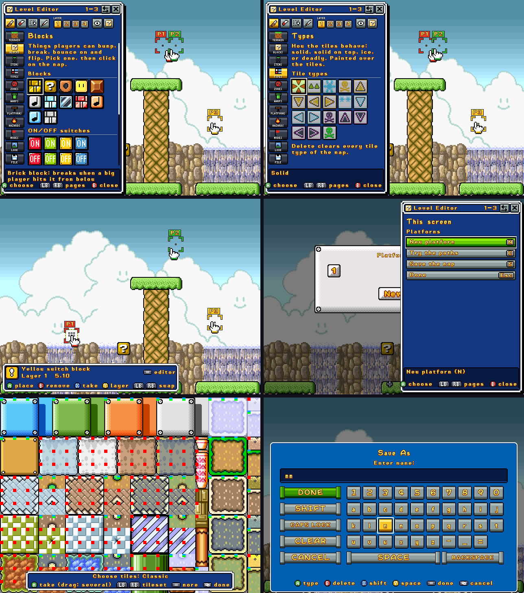
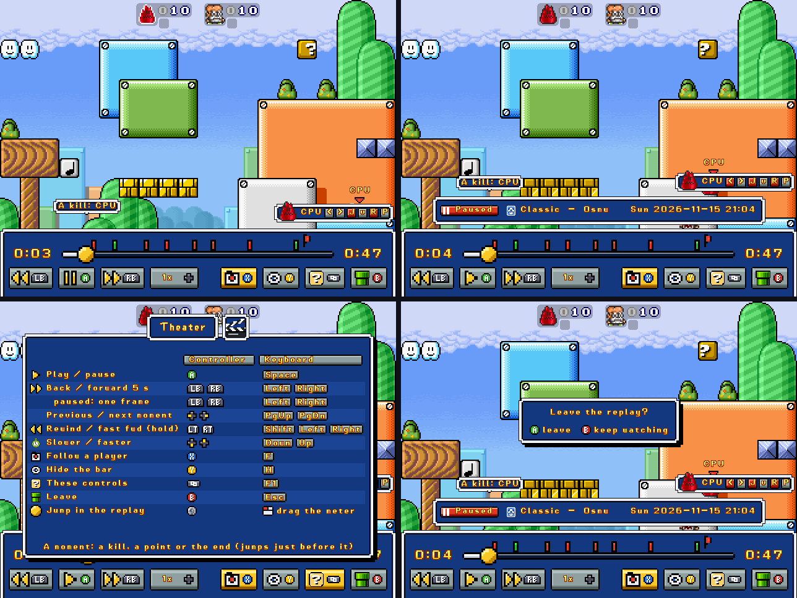
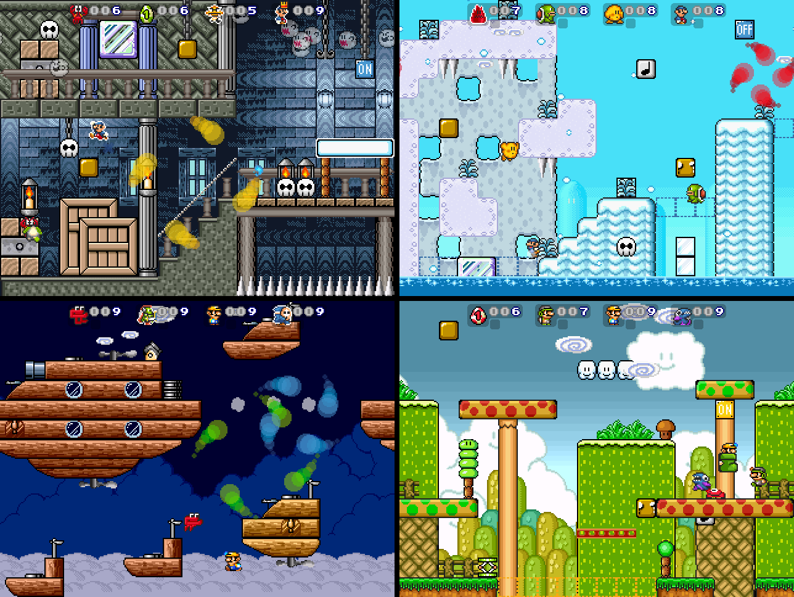

# Super Mario War

![Linux status][build-linux-img] ![Windows status][build-windows-img] ![macOS status][build-macos-img] [![Discord][discord-img]][discord-link]

Super Mario War is a fan-made multiplayer Super Mario Bros. style deathmatch game in which players try to beat one another in a variety of gameplay modes. You can play on teams, design your own levels, design your own worlds, and much more!

> **About this fork.** This is a just-for-fun fork of [mmatyas/supermariowar](https://github.com/mmatyas/supermariowar). Basically everything added here was claude-slopped: I had Claude (Anthropic's AI) write the additions to the game for fun. All the credit for Super Mario War goes to Mátyás Mustoha ([mmatyas](https://github.com/mmatyas)), who made the fork this one is built on and keeps the game alive, and to the original developers: Samuele Poletto (*Mario War*), Florian Hufsky and the 72dpiarmy community (*Super Mario War*), and everyone who made the maps, skins, worlds and sounds over the years. See [History](#history) below.

- [What's new in this fork](#whats-new-in-this-fork)
  - [Online multiplayer](#online-multiplayer)
  - [Map and world editors in the game](#map-and-world-editors-in-the-game)
  - [Theater: replays of every match](#theater-replays-of-every-match)
  - [Improvements](#improvements)
- [History](#history)
- [About](#about)
- [Building](#building-instructions)
  - [Get the code](#get-the-code)
  - [Requirements](#requirements)
  - [Linux](#linux)
  - [Mac OSX](#mac-osx)
  - [Windows](#windows)
  - [ARM / Raspberry Pi](#arm-devices)
  - [Android](#android)
  - [Emscripten](#emscripten)
  - [Other devices](#other-devices)
  - [Build configuration](#build-configuration)
- [How to play](#how-to-play)


## What's new in this fork

### Online multiplayer


- **Rollback netcode** for up to four players: everybody connects directly to each other, no server. Inputs that arrive late are predicted and corrected, so the game stays responsive with lag.
- **A full online lobby**: pick your character and team, see everyone's ping, add CPU players, and play tournaments, tours and worlds online. Missing maps and custom skins are sent to the players who don't have them.
- **No port forwarding (usually)**: the host's router is asked to open the port with UPnP, and the lobby shows the address friends join at.
- If someone drops out, **the CPU takes over** their player and the match goes on.
- **LAN games and system link**: games hosted on your network are listed by themselves, with their mode, map, players and connection, and joined with one button, between PCs and Xboxes alike.

See [docs/netplay.md](docs/netplay.md) for how to play and how it works.

### Map and world editors in the game



- **Make and edit maps and worlds right in the game** (**Main menu, Editors**), with a mouse and keyboard or a controller: rectangles, fill, copy and paste, and undo.
- **Edit together**: one player hosts a map or a world, the others join and edit it with them at the same time, online or on one computer.

### Theater: replays of every match



- Every match is saved as a small replay (the inputs, not a video), with the skins, the music and the players' pings. **Main menu, History** lists your matches.
- The **theater** plays them back with a timeline (score changes and kills marked on it), pause, frame stepping, fast forward and rewind, smooth slow motion, a camera that follows any player, and jumping to any moment, with a controller or the mouse and keyboard.

See [docs/HistoryReplaysEditors.md](docs/HistoryReplaysEditors.md).

### Improvements



- **Smarter CPU players** that find their way around a map: running jumps, warp pipes, ? blocks and power-ups, and better fighting.
- **50 more classic community maps**.


## History

*The history below is from the original README, in mmatyas's words.*

The original *Mario War* was created by *Samuele Poletto* in 2002, in which four Super Mario characters could fight on various levels by jumping on each other's head. It was written in Pascal/Assembly, and was released for DOS. Later versions also included a map editor.

In 2004, *Florian Hufsky*, founder of the *72dpiarmy* forum started working on an open-source rewrite, which became *Super Mario War*. This version introduced custom characters, additional gameplay modes and map mechanics, items and powerups. Custom user contents were stored on (the now defunct) `smwstuff.com` site, with thousands of maps and skins available. Due to its open-source nature, the game has been ported to pretty much every desktop and console system.

At the end of 2009, Florian died. The development of the game slowed down and eventually stopped, with SMW 1.8 beta 2 being the last official release. While there have been several attempts for continuing or restarting the development, none of them seem to have succeeded in the long term. In addition, due to technical issues the whole `smwstuff.com` site and all of its contents has also been lost, with partial backups from the uploaders available on the forum.

This is a fork I've started working on around 2014, with the initial goal of implementing network multiplayer support that would work cross-platform between different devices. I've also wanted to make a site for collecting the scattered content from the forum in one place once again. This became [`smwstuff.net`](http://smwstuff.net).

As for the game, unfortunately it became clear very soon that the quality and structure of the original source code will make effective work impossible: most source files were in the "around 10000 lines" category, with 1000+ LOC functions being common, most of them modifying global variables, and there was even an `if-else` with a hundred branches.

Eventually I've managed to make the network multiplayer working (with a lobby server, since removed and replaced by rollback netcode), but it was far from perfect. With good conditions, on local networks it may work fine, but subtle bugs and lag usually makes the gameplay over the internet far from optimal. A proper implementation would likely require a redesign of several core parts of the game and another several hundred clean up/refactoring patches to make the code maintainable. And, with this kind of project of course, there's also a chance that next morning you get a cease-and-desist letter from whatever company.

For me, this was the point where I've stopped putting more time on this project (2016). In the long term, a complete rewrite might be faster and more effective than patching the original game for years. Either way, I hope I've left the project in a better state than it was, and that it will be of use for future developers. Have fun!

Update, 2026: Looks like I've ended up working on it some more. While keeping the game alive, there also has been significant effort to modernize the codebase and try to make it maintainable. There have been some performance improvements, stability fixes, we have an SDL3 port, and the game continues to support newer operating systems. There's also [Super Cat Wars](https://gamejolt.com/games/supercatwars/627452), a complete overhaul mod with its own graphics, maps, and worlds. Give it a try!

[Old releases for Mario War and SMW can be found here.](https://github.com/mmatyas/supermariowar/releases/tag/1.8)

### Main changes since 1.8

- Experimental online mode with rollback netcode: players connect directly to each other, there is no lobby server (see [docs/netplay.md](docs/netplay.md))
- Lots and lots and lots of bugfixes (seriously, there's at least 200)
- Added Web, ARM and (an experimental) Android ports, and improved support for Windows, Linux and OSX
- Improved music and sound quality
- Ported all parts of the game to SDL2, for hardware accelerated drawing and improved support for many platforms
- Major cleanup of the source code and the build system


## About

Super Mario War is a Super Mario multiplayer game. The goal is to stomp as many other Mario's as possible to win the game. There is a range of different gameplay modes in the game, like Capture-The-Flag, King of The Hill, Deathmatch, Team Deathmatch, Tournament Mode, Collect The Coins, Race, and many more. The game also includes a level editor which lets you create your own maps from scratch, or re-create sections from your favorite Mario game, your imagination is the limit! Recently included is a world editor, which strings a bunch of levels with specified conditions to create an SMB3-like experience merged with tournament like play. The game is more importantly a tribute to Nintendo and the original fangame game Mario War by Samuele Poletto.

The game uses artwork and sounds from Nintendo games. We hope that this noncommercial fangame qualifies as fair use work. We just wanted to create this game to show how much we adore Nintendo's characters and games.

### Features

- Up to four players deathmatch fun
- a whole bunch of game modes (featuring GetTheChicken, Domination, CTF, ...)
- online and local multiplayer
- Comes with the leveleditor - you can create your own maps...
- ... and a lot of people did so. There are currently over 1000 maps
- More fun than poking a monkey with a stick
- The whole source code of the game is available, for free
- uses SDL and is fully portable to windows, linux, mac, ...
- CPU Players
- will make you happy and gives you a fuzzy feeling

### Online play

Up to four players can play online with rollback netcode (experimental): one player hosts a lobby from **Main menu, Online**, the others join it with the host's address. The game uses UDP port 7300 by default; the host's router is asked to forward it automatically (UPnP), and if it can't, the host forwards it by hand (nothing is needed on the same LAN). All players need the same version of the game. See [docs/netplay.md](docs/netplay.md) for how to play and for the developer documentation.

### Supported platforms

- Linux
- Windows
- Mac OS X
- ARM devices (eg. Raspberry Pi)
- XBox (?)
- Android (experimental)
- asm.js (experimental)


## Building instructions

### Requirements

- C++20 supporting compiler
- CMake
- SDL 3, with SDL_image and SDL_mixer
  - in case you still want to use SDL 2, consider building the `sdl2` branch
- zlib
- toml11
- ENet (optional)

If you're using package managers, you can get them like this:

- Debian-based: `apt install cmake libsdl3-dev libsdl3-image-dev libsdl3-mixer-dev zlib1g-dev libtoml11-dev libenet-dev`
- Fedora/RPM: `yum install cmake SDL3-devel SDL3_image-devel SDL3_mixer-devel zlib-devel toml11-devel enet-devel`
- Arch: `pacman -S cmake sdl3 sdl3_image sdl3_mixer zlib toml11 enet`

If a dependency is not available on your system, CMake will automatically try to download and build it.

### Get the code

The game assets are included as a Git submodule, so you'll likely want to do a recursive clone:

```sh
git clone --recursive https://github.com/nrgst183/supermariowar.git
```

Alternatively, you can also initialize the submodules manually:

```sh
git clone https://github.com/nrgst183/supermariowar.git
cd supermariowar
git submodule update --init
```

If you'd rather use the system libraries, please see the [Build configuration](#build-configuration) section for disabling this feature.

### Linux

Create a build directory and run CMake there to configure the project. Then simply call `make` every time you want to build. In short:

```sh
mkdir build && cd build
cmake ..
make -j4 # -jN = build on N threads
./smw --datadir ../data
```

The main build targets for `make` are:

- smw
- smw-leveleditor
- smw-worldeditor

If you prefer to work within an IDE (CodeBlocks, Eclipse, ...), you can also generate project files for it using CMake. You can find more information in [Build configuration](#build-configuration).

To create installable packages, simply run `make package`. This will create TGZ, DEB and RPM archives.

### Mac OSX

You'll probably need Xcode and its command line tools; you can install SDL and CMake manually from its site, or you can get them with Homebrew: `brew install cmake sdl2 sdl2_image sdl2_mixer`. Then follow the Linux instructions to build SMW.

### Windows

If you're using MinGW Shell/MSYS or Cygwin, you can follow the Linux guide. You can also generate a project file with CMake for various IDEs, such as CodeBlocks, Eclipse or Visual Studio.

**Visual Studio solution:** run `generate-vs-solution.bat` in the repository root. It generates `build\vs\smw.sln` (`smw.slnx` with Visual Studio 2026) for the newest installed Visual Studio and opens it. SDL3 and the other libraries are downloaded and built automatically on the first run. `smw` is the startup project and runs against the repository's `data` folder, so F5 starts the game. Building also copies the `data` folder next to the executables (only changed files after the first build), so `smw.exe` in `build\vs\Debug` or `build\vs\Release` can be started directly too. Re-run the script after adding or removing source files.

**Visual Studio "Open Folder":** opening the repository folder directly also works; pick the `Windows x64 Debug (MSVC)` or `Windows x64 Release (MSVC)` configuration from `CMakePresets.json`.

For more details, see the wiki: [Building on Windows](https://github.com/mmatyas/supermariowar/wiki/Building-on-Windows).

### ARM devices

You can build SMW on ARM devices, like the Raspberry Pi, following the Linux instructions. If you know how to do it, you can also cross-compile the usual way, either by setting up a cross toolchain or emulating your device. For more details, see the wiki: [Cross compiling to ARM](https://github.com/mmatyas/supermariowar/wiki/Cross-compiling-to-ARM).

The build configuration contains some default compiler flags already, but since there are many possible combinations (hard float, Thumb, NEON, ...), you might want to use custom parameters. In this case, define the CFLAGS and CXXFLAGS vars, and run CMake with the `DISABLE_DEFAULT_CFLAGS` option (see [Build configuration](#build-configuration)).

### Android

The Android port uses a different build system, you can find more details [here](https://github.com/mmatyas/supermariowar-android).

### Emscripten

SMW can be build to run in your browser using [Emscripten](https://kripken.github.io/emscripten-site/). You can find the build instructions in the [wiki](https://github.com/mmatyas/supermariowar/wiki/Building-the-Emscripten-port).

### Other devices

You should be able to port SMW to any device where SDL (either 1.2 or 2.0) works. Generally, this involves the following steps:

- get the cross compiler toolchain of your device
- cross-compile the SDL libs, if they are not included
  - build SDL
  - build SDL_image with at least PNG support
    - requires zlib
    - requires libpng
  - build SDL_mixer with at least OGG support
    - requires libogg
    - requires libvorbis
- create a CMake toolchain file and define your compiler and paths
- build using the toolchain file

### Build configuration

You can change the build configuration by setting various CMake flags. The simplest way to do this is by running `cmake-gui ..` from the `Build` directory. You can read a short description of an element by hovering the mouse on its name too.

Alternatively, you can pass these options directly to CMake as `-DFLAGNAME=VALUE` (eg. `cmake .. -DUSE_BUNDLED_SDL=ON`).

*TODO: expand this section*

### Releases

Every push is built for Linux, macOS, Windows (MinGW and MSVC) and the web by GitHub Actions.

- Pushing a version tag, e.g. `git tag v2.1.0 && git push origin v2.1.0`, publishes a GitHub release with the packages of every platform and generated release notes. Tags with a suffix, such as `v2.1.0-beta.1`, are published as pre-releases.
- Every push to the default branch updates the `continuous` pre-release with the latest build.

## How to play

Please see documentation in the docs/ directory.


[build-linux-img]: https://github.com/mmatyas/supermariowar/actions/workflows/build_linux.yml/badge.svg?branch=master
[build-windows-img]: https://github.com/mmatyas/supermariowar/actions/workflows/build_windows.yml/badge.svg?branch=master
[build-macos-img]: https://github.com/mmatyas/supermariowar/actions/workflows/build_macos.yml/badge.svg?branch=master
[discord-img]: https://img.shields.io/badge/Discord-7389D8?logo=discord&logoColor=white
[discord-link]: https://discord.gg/SC4uXQB
