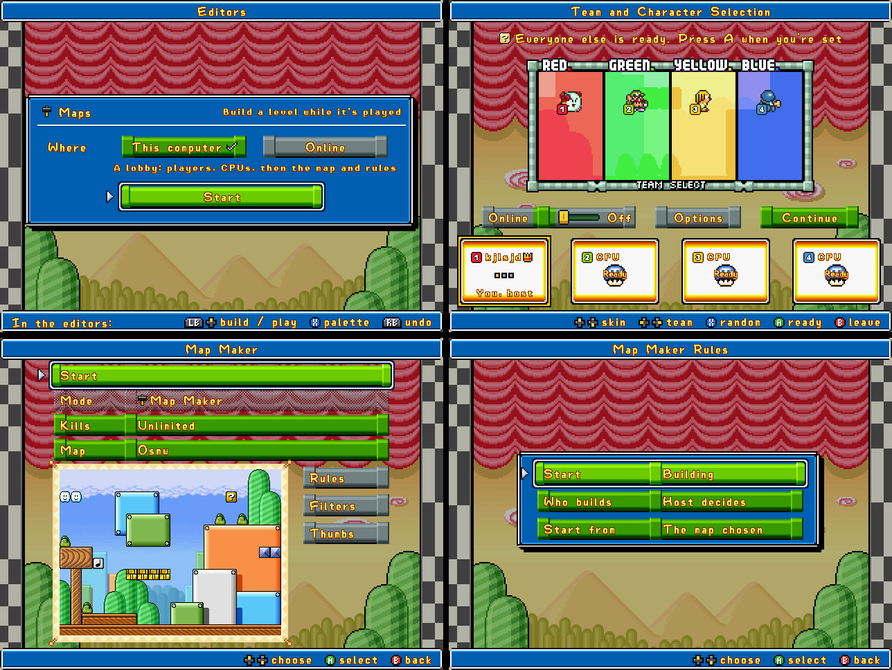

# Match history, replays and the built-in editors

## Match history (main menu > History)

Every match is added to the history when it ends or is left, local or online:

- `match_history.txt` in the settings folder: a log to read (date, mode and goal, map,
  length, the teams with their players, skins and final scores, the winner)
- `match_history.jsonl`: the same, one JSON object per line (for tools; the History
  screen reads it)
- `replays/*.smwr`: the replay of each match (the newest 200 are kept)

The History screen lists the matches, newest first (up/down, left/right a page), with the
selected match's details below. Select plays its replay.

## Replays

The simulation is deterministic (rollback netplay depends on it), so a replay is the
match config (settings, players, map, RNG seed) plus every tick's input, a few KB per
minute (`src/smw/rollback/Replay.h`). The map file is stored too: a replay still plays
after the map was changed or deleted. So are the players' skin files (a skin that isn't
on this computer, or is a different file here, goes to the downloaded skins) and the
music: the song the match started with and every change of song, by tick, since a match
picks its songs at random; the theater plays the same songs at the same moments, also
after a jump. An online replay also keeps every other player's ping, averaged over each
second as the recording computer saw it: the theater shows it as signal bars on their
score panels, like the match did (Graphics > Ping Bars turns them off, in matches and replays). Every 60 ticks a state checksum is stored; if a replay plays differently
(another game version) the theater says so. Replays from before the skins and songs were
stored still play, with the skins found by name and random songs.

CPU players are recorded like the humans: their AI runs outside the simulation and its
buttons are the CPU's input in every tick (`src/smw/CpuDriver.h`). So a replay plays the
CPUs exactly as they played, also after the AI was changed (the AI no longer decides
anything inside the replay). Each player's input is stored as runs of equal bytes, so four
CPUs add about 5 KB per minute. Replays from before this (version 3 and older) still run the
AI inside the simulation, so they play as recorded only with the AI of their time.

`smw --replay FILE` plays one at startup (with `--autotest`: then quits).

## The theater

Replays play in the theater (`src/smw/GameplayTheater.cpp`), modelled on Halo 3's. Its dock
along the bottom is a riveted panel (Graphics > Overlay Colors: Night, the default, dark blue
in SMB3's white status bar frame; Pipe, the game's green dialog; Castle; SMB3, the status
bar's own blue; the editors' panels use the same
colors, see `src/smw/ui/SmwTheme.h`): the timeline is a line (white as far as the
replay has played, a gold knob for the playhead, flags in the scoring team's color, a checkered
flag at the end of the match) with the buttons under it. Each button shows the controller
button or the key that does the same, for the device used last; any connected controller
works.

| | Controller | Keyboard | Mouse |
|---|---|---|---|
| play / pause | A (or Start) | Space | the play button |
| back / forward 5 s (paused: a frame) | LB / RB | Left / Right | the arrow buttons |
| the previous / next moment (a kill, a point, the end: just before it) | d-pad left / right | PgUp / PgDn | |
| scrub (the playhead follows, faster the further it's pushed) | left stick | | click or drag on the meter |
| rewind / fast forward (held) | LT / RT | Shift+Left / Shift+Right | |
| slower / faster (1/4x to 8x) | d-pad down / up | Down / Up | the clock button (right click: slower) |
| follow a player (their name, the buttons they hold; the view zooms in on them, the scores stay as they are) | X | F | the camera button |
| screenshot (the match as shown, without the theater's bar), saved in `screenshots` in the settings folder | - (on the Xbox, use Cerbios's screenshot) | F12, Insert | |
| hide the bar | Y | H | the eye button |
| the controls | Back | F1 | the ? block |
| leave | B (asks first: A leaves, B stays) | Escape | the warp pipe |
| the start / the end | | Home / End | |

When a replay starts it is simulated once without sound or effects (a few ms), keeping a
snapshot every 4 seconds: jumping anywhere is instant.

## Button prompts

The theater and the editors draw controller buttons in two styles
(`src/smw/ui/InputPrompts.h`): the Xbox one (A B X Y, LB RB, LT RT, View and Menu) and the
original Xbox's (the Duke and the Controller S: the colored gem buttons, White and Black,
the L and R triggers, START and BACK). Controls > Button Prompts picks one: Original Xbox
(the default), Xbox, or Auto, which uses the style of the controller pressed last. Auto
recognises an original Xbox controller by its USB ids (Microsoft's and the licensed ones)
or its name; through an adapter that reports itself as an Xbox 360 pad, it shows the Xbox
style.

## The Map Maker (main menu > Editors > Maps)

A map is built in a match, while it's played (`src/smw/GameplayEdit.cpp`, the mode
`CGM_MapMaker`). **Editors > Maps** asks where (this computer, or online: host, or join from
the games list), then opens the usual lobby: players, CPUs, skins. **Continue** goes straight
to the map and the **Rules** (the mode can't be changed there, and the Map Maker isn't among
the other modes):

| Rule | |
|---|---|
| Start | Building (the players who may build start with a cursor) or Playing |
| Who builds | Host decides (the host gives and takes the right) or Everyone |
| Start from | The map chosen, or a blank map (a floor to stand on) |

There's no countdown: the match starts building at once. The CPU players play on the map as
it changes; so do the players who aren't building.

| Controller | Keyboard | Mouse | |
|---|---|---|---|
| D-pad / stick | arrows | move it | the cursor (the glove); held, it speeds up |
| A | Enter | left button | paint (held: along the way); with the rectangle, copy or fill: from where it's pressed. Shift held as you start dragging: a straight line (it keeps to the row or column) |
| B | Delete | right button | erase, the same way |
| X | Space | middle button | the palette |
| Y | Shift | click Layer on the toolbar | the next layer, round from 4 to 1 (1, 2 behind the players; 3, 4 in front). While you use the mouse, Shift is for straight lines instead |
| Y + Up / Down | Shift + Up / Down | Ctrl + wheel | the layer up or down (stops at 1 and 4; the cursor stays put while Y is held) |
| RB | Backspace, Ctrl+Z | back side button | undo your last stroke (a rectangle, fill or paste: all of it); hold it to keep undoing. It goes back as far as you like, to how the map started |
| LB + RB | Ctrl+Y, Ctrl+Shift+Z | forward side button | redo what you undid (hold to keep redoing). Changing the map again drops what's left to redo |
| LB + Y | T | click a tool on the toolbar | the next tool: pencil, rectangle, fill (the toolbar: any of the five) |
| | 2 - 8 | | the recent part with that number (the numbers are on the toolbar) |
| | F1 | | the controls sheet: every control on one page (also the pause menu's Controls) |
| LT / RT | Page Up / Page Down | | the palette's tab before / after (with the palette shut: it opens) |
| LB + Left / Right | Q / E | wheel (over the map), or click one | the recent parts: the one before / after (see below) |
| LB + Down | R | Ctrl + left button | copy what's under the cursor: it becomes the brush, with its settings (a ? block's contents, a fire bar's length, a platform's path) |
| LB + B | G | Ctrl + right button | pick up what's under the cursor, to move it: it's taken off the map and becomes the brush; paint to put it down (like grabbing a part in Mario Maker). Undo puts it back |
| LB + Up | Tab | | building to playing (you spawn where your hand is), and back (the cursor where your character is) |
| Start | Escape | | the pause menu (click a row, or right-click to resume) |

With the mouse, the glove is on the pointer and the cursor snaps to the cell under it at once (the
match has it a tick or two later: a jump to its column, then its row); painting, it goes a cell a
tick, so every cell on the way is painted. In the palette, click a tab (or the arrows at
the ends of the tab row, or scroll over it) and click what you want; the wheel scrolls the
tilesets and changes a setting; a right click, or a click off the palette, goes back. On the
keyboard, Escape in the palette goes back instead of pausing. The bars show the mouse's
buttons after the mouse was used, the keys after a key.

**The palette** (X) has its tabs in groups along the top: **Tiles**, **Blocks** (Blocks, ?),
**Items**, **Warps**, **Hazards** (Hazards, Moving), **Scene** (Backdrop, Music), **Rules**
(Types, Spawns) and **More** (Animated, Weather, Goals); the open group shows its pages instead
of its name. LT / RT (PgUp / PgDn) go along the tabs, Y through the tilesets on the **Tiles**
tab, A takes, B or X (the button that opened it) shuts it; its title line names what the cursor
(or the mouse) is on. It's always at the bottom of the screen, and while it's open the moving
platforms and the map's moving dangers (fire bars, rotodiscs, cannons and their Bullet Bills,
piranha plants) hold still, so the map is easy to see. On one screen there's only ever one: a
second player who opens theirs joins the first one's page, both hands picking in it. **Blocks** (all 30; Y: hidden or not; the
on/off blocks set how the map's switches start), **?** (random, one of the game's item sets,
or a mix: A adds or takes out a powerup), **Items**, **Warps** (a number's warps go to each
other), **Hazards** and **Moving** platforms (their settings under them: A, then left/right,
then A), **Backdrop**, **Music**, **Types** (a cell's type set apart from its tiles: solid,
ice, death...), **Spawns** (no-spawn zones: everyone's, a team's, the items'), **Animated**
tiles, **Weather** (clouds, ghosts, leaves, snow, fish, rain, bubbles, on each layer),
**Goals** (race goals, flag bases). The tools (pencil, rectangle, fill, copy, paste) are on the
toolbar.

**The toolbar** along the bottom (the top while your cursor is down there) shows the part in
hand, the **recent parts** (the last 8 you used, from the palette or copied off the map; click
one, or press its number, to use it: a few things without opening the palette), the five tools
(the one in use lit; click to change) and the layer, a button with its name ("Layer 3"; click
it for the next). While you hold tiles, the map shows the layer you're on: the rest a little
darker, the layers in front of yours see-through, your layer bright, and the layers in front of it
as faint ghosts over it (three on layer 1, none on layer 4). Under it, the bar shows only the main
buttons and "all controls" (F1, or Start for the pause menu's Controls). A short message over the
toolbar says what just happened (Undo, Redo, Copied Brick, Picked up Fire bar, Tool: Fill,
Layer 3, Map cleared). The first time anyone builds on a computer, three hints come up one after
another (paint, the parts, undo), each gone once it's been done. Placing, erasing, undoing and
changing the brush each make a sound, and the cells changed flash a ring (white put down, red
taken away, yellow undone). While you build, a faint grid marks the cells' corners around your
cursor, and when the cursor rests a moment a label over it names what's under it (what B would
erase, or LB + Down copy), outlined. The cursor shows what it's doing: red while erasing, the
tool's icon by it for anything but the pencil, marching dashes while it carries a picked-up part. A builder's scoreboard portrait, at the top, is framed in its color and shows its character and a
glove by turns, while it builds.
While someone builds, the things play doesn't show are marked near the builders' cursors: warps,
hazards, hidden blocks, race goals and flag bases (all of a kind while its part is in hand); with
the Types or Spawns brush, the map's types or zones.

**The pause menu**: Resume, Who builds (the host: left/right a player, A gives or takes the
right), Save map (as "*map* made", in the map list from then on; its filters and thumbnail
made again), Clear map (the host: everything placed goes, tiles, blocks, items, hazards,
platforms, warps, types and no-spawn zones, but not the backdrop, music or weather; press it
twice to be sure; one undo brings it all back), Controls (the controls sheet), Quit. Online the match can't pause: the online
panel (Start) has the rights, Save and Clear map, under the run-ahead.

Building is part of the simulation (a builder's buttons go in its input byte), so it plays
the same on every computer online, in rollbacks, and in the sync tests.

## The editors (main menu > Editors)

The Map Maker took the old map (level) editor's place in the menu: **Editors > Maps** opens the
Map Maker. The world editor is **Editors > Worlds**. The level editor is still in the code
(and `smw-leveledit` still builds); what follows is about both editors as they were.

The map (level) editor and the world editor run inside the game
(`src/smw/editors/EditorLauncher.h`). They are the standalone editors' code, compiled
into the game in their own namespaces; `smw-leveledit` and `smw-worldedit` still build
as before. The game's graphics, map lists and settings are set aside for a session and
come back afterwards; maps and worlds saved in an editor show up in the game's lists.

Both editors can be used with only a controller (`src/smw/editors/EditorInput.h`). On the
map:

| Controller | |
|---|---|
| Left stick | the cursor: a small push moves a pixel or so, a full one crosses the screen in about a second |
| D-pad | the cursor, one tile per press |
| A / B | place / remove; held while the cursor moves, the whole rectangle (map editor; world editor: hold to paint) |
| LT + A / B | map editor: paint / erase freely as the cursor moves (no rectangle) |
| X | map editor: take the block, item or tiles under the cursor (world editor: Shift) |
| Y | map editor: the next layer (world editor: Ctrl) |
| LB / RB | map editor: back and forth through the last 8 things picked (before that: the blocks, items and tile types) |
| LT / RT (held) | Shift / Ctrl (in move mode: Shift adds to the selection, Ctrl selects freehand) |
| Right stick | map editor: the cursor, slowly (a pixel or two); world editor: scrolls the world |
| Right stick pressed | the tools: undo, redo; on a map, copy an area, paste, fill (in move mode also: copy or delete the selection, replace or merge) |
| Left stick held | the whole map (the world: all of it, small), with everyone's cursor |
| Back | Escape: on the map, asks to leave (A chooses, B stays, left / right pick Yes or No) |
| Start | the editor window |

**The tools** (the right stick pressed, or the mouse's middle button): **Undo** and
**Redo** (also Ctrl+Z and Ctrl+Y) work in both editors, for every change: a stroke or a
rectangle is one undo, and online only your own changes are undone (a cell someone else
changed since keeps theirs). In the map editor, **Copy an area** takes every layer's tiles,
the blocks, warps and zones of the rectangle drawn with A; **Paste** then puts it down where
A is pressed, as often as wanted, until B; **Fill** paints the cells joined to the one
pressed that are the same as it (the same block, or tile on the active layer, or tile type).

The **tileset screen** works tile by tile: the d-pad moves a gold frame one tile at a time and
scrolls the tileset at the screen's edge, the stick's cursor settles on a tile when let go,
A held with the d-pad takes several tiles, LB / RB change the tileset, B goes back to the
map. Choosing a platform's tiles uses the same screen.

**? blocks:** the Modes page's "? block contents" (or K at the cursor) then A on a ? block
(or a click) opens what it gives. **Zones:** the Zones page picks whose zone (everyone's or
a team's) and marks, clears or inverts every cell. Clearing all the tile types, clearing the
map, a new map, and another map with changes unsaved ask to be chosen twice. F1 (or Help on
the File page) shows the controls for the controller, or the mouse and the keys.

In the editor's other screens (the tilesets, warps, platforms...) and the world editor,
RB is Enter and LB hides or shows the buttons' bar.

**The editor window** (Start, or Tab on a keyboard) docks at the side of the screen away
from the cursor: the tools, the layers (L1 to L4), the last things picked, and a page per kind of thing (blocks, items, tile
types, zones, warps, platforms, hazards, game-mode objects, the look, the file). Opened
with a controller, a white frame marks one entry: the d-pad or the left stick moves it
(the page scrolls along), A chooses, LB / RB turn the page, B closes. Choosing a block,
an item, a tile type or a tool goes straight back to the map with it. The mouse, and the
other controllers' cursors, click in it as well. With the window closed, the map editor's
chip (bottom left) shows what is selected, the layer and the cell, and the buttons.

The map editor's other screens (the tilesets, warps, platforms, hazards, race goals,
backgrounds, eyecandy...) show a strip with the screen's name and what the buttons do
there: A and B are the mouse's buttons, LB / RB do what the screen needs (the next
tileset or page, faster or slower, more or less often), and Start lists the screen's
commands (New, Delete, its path...) to choose with the d-pad. Back leaves the screen.
Every cursor, the mouse's too, is a white glove with a cuff in its player's color.

On a keyboard, every command keeps its key; the window lists them. Every cursor marks the
tile it edits with a frame in its player's color. With the mouse on the map editor's map:
Shift and a drag fills a rectangle (the right button clears it), Alt and a click takes the
cell, the wheel goes through the last things picked (with Ctrl: the layers), Ctrl+C and
Ctrl+V copy an area and paste it, and the middle button opens the tools.

When an editor asks for a name, an on-screen keyboard opens (A types, B deletes,
X shift, Y space, Start done, Back cancel; with the mouse: click the keys).

## Editing together

**On one computer:** every connected controller gets its own cursor (P1, P2, ...); each
paints and clicks where its cursor is. The editor's mode and selected tile are shared.

**Over the network** it's a game like a match: Editors > Maps (or Worlds) > Online > Host
opens a lobby (**Edit Together**) that the others find in **Join a Game** (listed as "Map
editor" or "World editor"), or join by address. The host's **Start editing** opens the
editor for everyone in the lobby, and whoever joins the lobby later is taken straight in; a
joiner who leaves the editor is back in the lobby, and **Join editing** goes back in. When
the host leaves the editor, everyone is back in the lobby. Everyone edits the same map or
world in their own game, and sees the others' cursors with their names (the lobby's), who is
there (bottom left), and who joins or leaves. The session goes over the lobby's connection
(port 7300), so it works wherever the lobby does.

Both work together: in a session over the network, every controller on each computer is its
own person. Picking one up during the session joins in ("Name P2 joined"), and the others see its
cursor ("Name P2", in a lighter shade of that computer's color) and its name in the list.

How it works (`src/smw/editors/CoEdit.h`): every game edits its own copy. Once per frame,
each compares its copy with the last synced state; every changed map cell, world tile or
section (items, hazards, platforms, backgrounds and music; stages, vehicles, warps, start
items) is sent as an operation. The host puts all operations in one order and sends them
to everyone, so all copies end up the same: when two people change the same cell at once,
the later one (in the host's order) wins everywhere. Because changes are found by comparing,
every tool of the editors works together without changes to the tools.

The host opens the map or world (the others get it when they join) and is the only one who
saves to its file, or switches to another map or world (that switches it for everyone).
The others may Save As a copy of their own.

## Testing

- `--autotest --replay FILE --at-replay-seeks N`: plays a replay with a random jump every
  N frames; the checksums after each jump must still match
- `--autotest --at-match shots --at-role history|theater|editors|controls --at-shots DIR`:
  screenshots of the history screen, the theater, both editors driven by a scripted
  controller (followed by a match, to check that the game came back intact), and the
  controls menu; `--at-prompts 1|2` draws the Xbox or the original Xbox buttons, `--at-colors 0-3` picks the
  overlay colors
- `--at-role cohost` and `--at-role cojoin --at-addr 127.0.0.1` (`--at-shotmap 1`: the
  world editor): two or more games edit together with scripted controllers, at the same
  time and on the same cells; each prints a hash of its document (`cotest:`), which must
  be the same everywhere. `--at-role colocal`: two controllers in one editor
- `--at-role matchedit`: the Map Maker as a person plays it: Editors > Maps, its lobby, its
  rules, then a scripted builder using every palette tab, the tools, the recent parts, copying
  from the map (a fire bar with its settings), picking up to move, Clear map and its undo, undo all the way back (`undotest:`),
  redo all the way (`redotest:`), the computer's keys and mouse buttons (`pctest:`), the keyboard's keys
  and the pause menu's Save (its map is removed afterwards). With `--at-synctest 8` every tick is
  rolled back and played again (0 mismatches); `--at-pace N` holds each button N frames and
  `--at-realtime 3` plays at normal speed, to watch it; `--at-mm-demo 1` plays a short demo of the newer controls, `--at-mm-demo 2` takes the README's
  screenshots (`s1_building`, `s2_palette`, `s3_controls`); `--at-mm-blank 1` / `--at-mm-start 1`
  set its rules. `--at-mode 22` plays it with CPU builders pressing random buttons
- `--at-role edux`: the map editor's screens with a controller (a ? block, the zones page,
  F1, the tileset screen's B, move mode's tools, the exit prompt); `--at-role edmouse`: the
  map editor with the mouse; `--at-role mouse`: the menus with the mouse; `--at-role
  menutour`: a screenshot of every menu; `--at-role mouseaudit`: on each menu screen, every control the keys
  get to must be one the mouse gets to too (it has a box on the screen, nothing else on top of it;
  `mouseaudit:` lines for any that aren't), and clicks on the lists and grids (the lobby's teams,
  the map thumbnails, the filters, the item sliders) must do what A does (`mouseclick:` lines)
